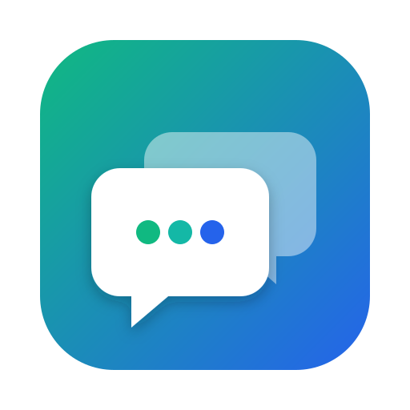

<p align="center">
  
</p>

<h1 align="center">ChatStack</h1>

<p align="center"><b>Tous tes comptes Google Chat dans une seule app macOS.</b><br/>
Notifications natives, badge dans le Dock, autant de comptes que tu veux.</p>

---

Google Chat ne gère pas bien plusieurs comptes Gmail en même temps : un onglet par compte, des notifications qui se perdent, aucun badge. ChatStack règle ça : une app dans le Dock, une icône par compte dans une barre latérale, et chaque compte reste connecté en permanence.

## Fonctionnalités

- **Multi-comptes illimité** : chaque compte tourne dans sa propre session isolée (cookies, stockage, cache). Tu restes connecté à tous en même temps.
- **Google Chat complet** : c'est la vraie interface Google Chat. Messages directs, espaces, fils de discussion (réponses dans le fil), réactions, mentions, fichiers, recherche, huddles… tout ce que fait Google Chat.
- **Notifications macOS natives** avec le nom du compte en sous-titre et l'avatar de l'expéditeur. Un clic ouvre le bon compte *et* la bonne conversation.
- **Badge du Dock** : total des non-lus de tous les comptes (ou simple pastille), rebond de l'icône à l'arrivée d'un message.
- **Icône dans la barre des menus** avec le compteur et un accès rapide à chaque compte.
- **Ne pas déranger** : 30 min, 1 h, 2 h, jusqu'à demain 8 h, ou sans limite.
- **Réglages par compte** : nom, couleur, notifications, son, inclusion dans le badge, zoom, URL (chat.google.com ou Gmail/Chat).
- **Reste actif en arrière-plan** : fermer la fenêtre ne coupe pas les alertes (⌘Q pour quitter).
- Lancement au démarrage du Mac, Google Meet dans le navigateur, menu contextuel complet (correcteur orthographique, liens, images), récupération automatique en cas de coupure réseau ou de plantage d'une page.

## Raccourcis

| Raccourci | Action |
|---|---|
| ⌘1 … ⌘9 | Aller au compte n |
| ⌃⇥ / ⌃⇧⇥ | Compte suivant / précédent |
| ⌘N | Ajouter un compte |
| ⌘, | Réglages |
| ⌘R | Recharger le compte affiché |
| ⌘+ / ⌘- / ⌘0 | Zoom du compte affiché |
| ⌘[ / ⌘] | Précédent / suivant |
| Échap | Fermer les réglages |

Clic droit sur un compte dans la barre latérale : recharger, couper ses notifications, modifier, supprimer.

## Installation

```bash
curl -fsSL https://raw.githubusercontent.com/ldubois/chatstack/main/install.sh | bash
```

Ou télécharger le `.dmg` depuis la page [Releases](https://github.com/ldubois/chatstack/releases).

> L'app n'est pas notarisée par Apple : le script d'installation retire l'attribut de quarantaine (`xattr -cr`). Si tu installes le DMG à la main, fais un clic droit → Ouvrir la première fois.

Au premier message, macOS demande l'autorisation d'afficher les notifications. Pour des alertes qui restent à l'écran jusqu'à ce que tu les fermes : **Réglages Système → Notifications → ChatStack → Alertes**.

## Développement

```bash
npm install
npm start            # lance l'app en mode développement
npm run lint
npm run typecheck
npm run make         # génère le .dmg et le .zip dans out/make
npm run generate-icons
```

Pour publier une version : bumper `version` dans `package.json`, puis `git tag v0.x.y && git push --tags`. La CI GitHub Actions construit le DMG et crée la release.

### Architecture

```
src/
  main.ts                 point d'entrée (instance unique, UA, About)
  main/controller.ts      fenêtre, mise en page des vues, IPC, badge Dock
  main/account-view.ts    une WebContentsView Google Chat par compte (session persist:account-<id>)
  main/notifier.ts        notifications web → notifications macOS
  main/menus.ts           menu de l'app + icône de la barre des menus
  main/store.ts           réglages JSON (userData/settings.json)
  main/web.ts             liens externes, menu contextuel, UA
  preload-account.ts      shim Notification / Badging API injecté dans Google Chat
  preload-shell.ts        API exposée à l'interface ChatStack
  renderer/               barre latérale + réglages (TypeScript + CSS, sans framework)
```

**Comment marchent les alertes ?** Google Chat utilise l'API web `Notification` pour ses alertes et l'API Badging pour son compteur. Le preload remplace ces deux API dans la page et transmet tout au process principal, qui affiche une notification macOS rattachée au bon compte. Au clic, il renvoie l'événement à la page : Google Chat ouvre alors la conversation. Le compteur de non-lus combine l'API Badging et le titre de la page.

**Connexion Google** : les vues utilisent un user-agent Chrome standard (sans « Electron »), sinon Google refuse la connexion dans une app intégrée.

## Vie privée

ChatStack ne passe par aucun serveur tiers et ne collecte rien : il affiche seulement les pages Google Chat. Les sessions sont stockées localement dans `~/Library/Application Support/ChatStack/Partitions/`, et supprimer un compte efface sa session.

## Licence

MIT
